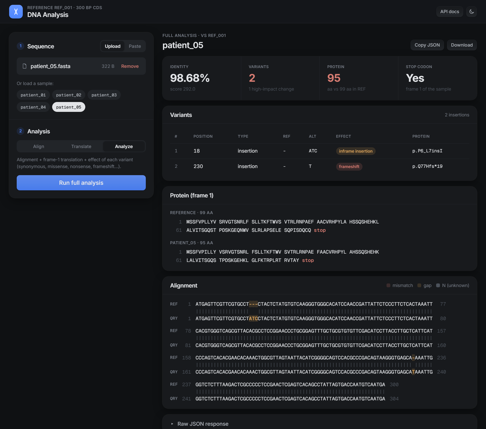
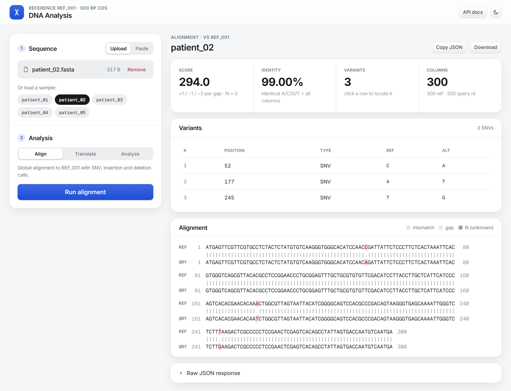

# DNA Analysis API

[](https://github.com/frederick-allensius/bioinformatic-engineer-technical-test/actions/workflows/ci.yml)

A small REST API for DNA sequence analysis against a fixed reference (`REF_001`, a 300 bp synthetic coding sequence):

| Endpoint | What it does |
|---|---|
| `POST /api/align` | Global alignment to the reference + variant detection (SNV, insertion, deletion) |
| `POST /api/translate` | Translation to protein in reading frame 1, 2 or 3 |
| `POST /api/analyze` *(bonus)* | Alignment + translation + variant effect annotation (synonymous, missense, nonsense, frameshift, in-frame indel) |
| `GET /` *(bonus)* | Web interface for all of the above |

Built with **FastAPI**. The Needleman-Wunsch aligner and the translator are **implemented from scratch** (no bioinformatics library at runtime). Biopython is used **only in the tests**, as an independent oracle to cross-check the results.



---

## Contents

- [Highlights](#highlights)
- [Quick start](#quick-start)
- [API reference](#api-reference)
- [Results on the supplied samples](#results-on-the-supplied-samples)
- [Methods and conventions](#methods-and-conventions)
- [Testing](#testing)
- [Project structure](#project-structure)
- [Assumptions](#assumptions)
- [Limitations and future work](#limitations-and-future-work)

## Highlights

- **Matches the task's example responses exactly.** `patient_02` gives score `294.0`, identity `0.99`, the three SNVs at 52/177/245 and the 81-residue protein.
- **Deterministic, biologically sensible alignments.** Among equally scoring alignments, the one with the fewest gap openings wins, so a 3 bp deletion is never split into 2 + 1. Indels in repeats are left-aligned.
- **Verified against independent oracles.** The aligner is checked against brute-force enumeration of *every* possible alignment (optimality and tie-break) and against Biopython's `PairwiseAligner`. The codon table and translations are checked against Biopython.
- **258 tests, 99% coverage.** Every item in the brief's test list is covered (see [mapping](#what-is-tested)), and the test suite rebuilds each patient sequence from the reported variants.
- **One error format everywhere.** Every error is `{"error": {"code", "message", "field"}}`, and messages point at the offending line/column.
- **All bonus items.** Web UI, multi-stage Dockerfile, `/api/analyze` with HGVS-style protein changes, and the from-scratch implementation. CI runs lint + tests on Python 3.11 to 3.13 and builds/smoke-tests the Docker image.

## Quick start

### Run locally (Python 3.11+)

```bash
git clone https://github.com/frederick-allensius/bioinformatic-engineer-technical-test.git
cd bioinformatic-engineer-technical-test

python -m venv .venv
source .venv/bin/activate          # Windows: .venv\Scripts\activate
pip install -r requirements.txt    # API + test dependencies

uvicorn app.main:app --reload      # http://localhost:8000
```

- Web UI: <http://localhost:8000>. Try <http://localhost:8000/?sample=patient_05&mode=analyze>.
- Interactive API docs (Swagger): <http://localhost:8000/docs> · ReDoc: <http://localhost:8000/redoc>

### Run with Docker

```bash
docker build -t dna-analysis-api .
docker run --rm -p 8000:8000 dna-analysis-api
```

The runtime image installs runtime dependencies only, runs as a non-root user and has a `HEALTHCHECK` on `/api/health`. To run the test suite inside the image:

```bash
docker build --target test -t dna-analysis-api:test . && docker run --rm dna-analysis-api:test
```

### Configuration

All settings have sensible defaults and can be overridden with environment variables:

| Variable | Default | Meaning |
|---|---|---|
| `DNA_API_REFERENCE_PATH` | `data/reference.fasta` | Reference FASTA loaded once at start-up |
| `DNA_API_MAX_SEQUENCE_LENGTH` | `1000` | Maximum query length (nt) |
| `DNA_API_MAX_UPLOAD_BYTES` | `1048576` | Hard cap on the raw upload, checked before parsing |

## API reference

All analysis endpoints take `multipart/form-data` with the FASTA file in the field **`file`**. The reference is loaded by the server and is not part of the request.

### `POST /api/align`

```bash
curl -X POST http://localhost:8000/api/align \
  -F "file=@samples/patient_03.fasta"
```

```jsonc
{
  "sequence_id": "patient_03",
  "reference_id": "REF_001",
  "alignment": {
    "score": 288.0,
    "identity": 0.9867,
    // complete strings are returned; shortened here around the two deletions
    "reference_aligned": "...CGCCTCCGGAACCCTGCGG...CAGTCCACGCCCGAC...",
    "query_aligned":     "...CGCCTCCGG---CCTGCGG...CAGTCC-CGCCCGAC..."
  },
  "variants": [
    {"position": 106, "ref": "AAC", "alt": "-", "type": "deletion"},
    {"position": 208, "ref": "A",   "alt": "-", "type": "deletion"}
  ]
}
```

### `POST /api/translate`

`frame` is optional (`1`, `2` or `3`; default `1`).

```bash
curl -X POST http://localhost:8000/api/translate \
  -F "file=@samples/patient_02.fasta" -F "frame=1"
```

```json
{
  "sequence_id": "patient_02",
  "frame": 1,
  "protein": "MSSFVPLLYVSRVGTSNRLFSLLTKFTWVSVTRLRNPAEFAACVRHPYLAHSSQSHEHNLALVITSGQSTPDSKGEQNWVS",
  "length": 81,
  "has_stop_codon": true
}
```

### `POST /api/analyze` (bonus)

```bash
curl -X POST http://localhost:8000/api/analyze \
  -F "file=@samples/patient_02.fasta"
```

```jsonc
{
  "sequence_id": "patient_02",
  "reference_id": "REF_001",
  "alignment": { "score": 294.0, "identity": 0.99, "reference_aligned": "...", "query_aligned": "..." },
  "variants": [
    {
      "position": 245, "ref": "T", "alt": "G", "type": "SNV",
      "effect": "nonsense",
      "codon": 82, "ref_codon": "TTA", "alt_codon": "TGA", "ref_aa": "L", "alt_aa": "*",
      "protein_change": "p.L82*",
      "notes": []
    }
    // ... p.R18= (synonymous) and p.K59N (missense) omitted for brevity
  ],
  "translation":           { "frame": 1, "protein": "MSSFVP...EQNWVS", "length": 81, "has_stop_codon": true },
  "reference_translation": { "frame": 1, "protein": "MSSFVP...PISDQCQ", "length": 99, "has_stop_codon": true },
  "effect_counts": { "synonymous": 1, "missense": 1, "nonsense": 1, "stop_lost": 0, "frameshift": 0,
                     "inframe_insertion": 0, "inframe_deletion": 0, "undetermined": 0 }
}
```

### `GET /api/health`

```json
{"status": "ok", "version": "1.0.0", "reference_id": "REF_001", "reference_length": 300}
```

### Errors

Every error, including 404/405 and unexpected 500s, uses the same envelope:

```bash
curl -X POST http://localhost:8000/api/translate -F "file=@two_records.fasta"
```

```json
{
  "error": {
    "code": "multiple_records",
    "message": "Expected exactly one FASTA record but found 2 (additional header on line 3).",
    "field": "file"
  }
}
```

**400** means the request is missing something required. **422** means the request is well-formed but its content is invalid.

| Status | `code` | When |
|---|---|---|
| 400 | `missing_file` | No `file` part in the request |
| 422 | `empty_file` | File is empty or whitespace only |
| 422 | `malformed_fasta` | First non-blank line is not a `>` header |
| 422 | `empty_header` | Header has no identifier after `>` |
| 422 | `empty_sequence` | Header present but no sequence |
| 422 | `multiple_records` | More than one `>` header |
| 422 | `invalid_character` | Anything other than A/C/G/T/N (any case); message gives line and column |
| 422 | `embedded_whitespace` | Space/tab inside a sequence line |
| 422 | `sequence_too_long` | More than 1,000 nt after removing line breaks |
| 422 | `invalid_encoding` | File is not UTF-8 text |
| 422 | `file_too_large` | Raw upload above `DNA_API_MAX_UPLOAD_BYTES` |
| 422 | `invalid_frame` | `frame` is not exactly 1, 2 or 3 (e.g. `0`, `4`, `1.5`, `abc`) |
| 422 | `invalid_request` | Other request validation errors (e.g. `file` sent as a text field) |
| 404 / 405 | `not_found` / `method_not_allowed` | Unknown path / wrong method |
| 500 | `internal_error` | Unexpected error (details are logged, not leaked) |

## Results on the supplied samples

Produced by the API with the default scoring (reproduced by the test suite):

| Sample | Length | Score | Identity | Variants | Effect (`/api/analyze`) | Protein (frame 1) |
|---|---|---|---|---|---|---|
| patient_01 | 300 | 300.0 | 1.0 | none (identical to REF_001) | | 99 aa + stop |
| patient_02 | 300 | 294.0 | 0.99 | SNV 52 C>A<br>SNV 177 A>T<br>SNV 245 T>G | synonymous `p.R18=`<br>missense `p.K59N`<br>nonsense `p.L82*` | 81 aa + stop |
| patient_03 | 296 | 288.0 | 0.9867 | deletion 106 `AAC`<br>deletion 208 `A` | in-frame deletion `p.N36del`<br>frameshift `p.T70Rfs*13` | 80 aa + stop |
| patient_04 | 300 (170 N) | 130.0 | 0.4333 | none: N is never an SNV | | 99 aa + stop (59 `X`) |
| patient_05 | 304 | 292.0 | 0.9868 | insertion 18 `ATC`<br>insertion 230 `T` | in-frame insertion `p.P6_L7insI`<br>frameshift `p.Q77Hfs*19` | 95 aa + stop |

## Methods and conventions

### Input validation (shared by all endpoints)

- Exactly **one** FASTA record with a **non-empty header**. `sequence_id` is the first whitespace-delimited token after `>` (`>REF_001 synthetic CDS, 300 bp` gives `REF_001`).
- **1 to 1,000 nucleotides** after removing line breaks and surrounding whitespace. Multiline sequences and blank lines (anywhere) are allowed. `\n`, `\r\n` and `\r` line endings and a UTF-8 BOM are accepted.
- Only **A, C, G, T, N**, case-insensitive. The sequence is upper-cased. **N is valid**, even for an all-N sequence.
- Whitespace *at the ends* of a line is trimmed. Whitespace *inside* a sequence line is rejected (`embedded_whitespace`).
- The upload is read with a byte cap before parsing, so a huge file is never fully loaded into memory.

### Alignment

**Algorithm:** global Needleman-Wunsch, implemented as a three-state (Gotoh) dynamic program in pure Python. O(n·m) time and memory. It takes about 0.1 s for 300 × 300 and about 0.3 s for the worst case of 300 × 1,000.

**Scoring** (defaults are the task's example scheme, so the example is reproduced exactly):

| Column | Score |
|---|---|
| identical A/C/G/T | **+1** |
| different A/C/G/T | **−1** |
| any column with an **N** (N/base or N/N) | **0** |
| gap character (insertion or deletion) | **−2** per gap character (linear) |

- **N scores 0** because N is an unknown base: it should neither reward nor penalise the alignment, and it should never pull the aligner into a gap. With N = 0 a long N run stays on the diagonal (see `patient_04`).
- **End gaps are penalised** like internal gaps (true global alignment), since the query and reference are the same complete fragment.

**Tie-breaking (deterministic):** with a linear gap penalty many alignments share the optimal score. For example, a 3 bp deletion can be written as one gap or as `--C-`. Ties are resolved in this order:

1. **Fewest gap openings.** Internally every score is multiplied by `K = n + m + 1` and each gap opening costs an extra `−1`. An alignment can never have `K` or more openings, so this term can only decide *between* alignments whose primary scores are equal. It never changes the optimal score itself. As a result, consecutive indel bases stay grouped as one event.
2. **Fixed traceback preference: (mis)match > deletion > insertion.** Traceback runs from the 3′ end, so preferring the diagonal pushes gaps as far 5′ as possible. Indels in repeats are therefore **left-aligned**, the same convention VCF normalisation uses (`GCACACAT` vs `GCACAT` reports the deletion of `CA` at position 2).

The returned `score` is recomputed from the returned alignment columns, so it always describes exactly the alignment you see.

### Identity

```
identity = identical A/C/G/T columns / all alignment columns (gaps and N columns included)
```

N/N is **not** a match. Values are rounded to 4 decimals (`patient_02`: 297/300 = 0.99).

### Variant conventions

| Type | `position` (1-based, reference coordinates) | `ref` | `alt` |
|---|---|---|---|
| `SNV` | the substituted base | reference base | query base |
| `deletion` | **first deleted** reference base | deleted sequence | `-` |
| `insertion` | reference base **preceding** the insertion (`0` = before base 1) | `-` | inserted sequence |

- SNVs are called **only** between two different A/C/G/T bases. A column containing N is never an SNV.
- Consecutive gap columns of the same kind are **grouped** into one event. Events are **sorted by position**. On the same position, alignment order is kept, so a deletion at *p* comes before an insertion after base *p*.
- `variants` is `[]` when nothing is found. VCF output and normalisation are out of scope.

### Translation

- **Standard genetic code** (NCBI table 1). The codon table is built from the canonical `TCAG` ordering and verified against Biopython.
- Frame 1/2/3 starts at nucleotide 1/2/3 of the supplied strand. There is **no start-codon search and no reverse complement**.
- Only complete codons are translated. **1–2 trailing nucleotides are ignored.**
- **Any codon containing N becomes `X`**, even when the amino acid is inferable (`GCN` → `X`, not `A`). `TNA` is therefore `X`, not a stop.
- Translation stops **before** the first unambiguous stop (TAA/TAG/TGA). `*` is never emitted, `has_stop_codon` says whether one was reached, and `length == len(protein)` including `X`.
- A frame with no complete codon returns `protein: ""`, `length: 0`, `has_stop_codon: false`.

### Variant effect annotation (`/api/analyze`, bonus)

Effects are relative to **reference frame 1** (the CDS starts at base 1):

| Effect | Rule |
|---|---|
| `synonymous` | SNV(s); codon translates to the same amino acid (incl. stop→stop) |
| `missense` | SNV(s); different amino acid |
| `nonsense` | SNV(s); amino acid → stop |
| `stop_lost` | SNV(s); stop → amino acid (extension beyond the brief's list, as the reference ends in TGA) |
| `frameshift` | indel length not a multiple of 3 |
| `inframe_insertion` / `inframe_deletion` | indel length a multiple of 3 |
| `undetermined` | cannot be decided reliably (see below) |

- **Ambiguous codons:** if the codon holding an SNV contains an `N` (in the query or reference), the effect is `undetermined`. The API does not guess.
- **Multiple nearby variants:**
  - SNVs in the **same codon** are evaluated **together**: the alternative codon is read straight from the alignment. For example `AGC`→`TCC` is synonymous (Ser→Ser), even though each SNV alone would be missense. Each such SNV gets a note naming its partners.
  - An SNV whose codon is **also hit by an indel** is `undetermined`.
  - Each indel is classified by its own length. For `protein_change`, the indel alone is applied to the reference and the two translations are compared.
  - Variants are annotated independently against the reference frame, as VEP does. Interactions are reported in `notes`: variants **downstream of a frameshift** or of a **premature stop**, and an indel that **restores the reading frame**. The `translation` field shows the protein the sample actually encodes.
- **`protein_change`** uses simplified one-letter HGVS-style notation: `p.L82*`, `p.R18=`, `p.N36del`, `p.A2_K3delinsE`, `p.P6_L7insI`, `p.T70Rfs*13` (new stop is residue 13 counting the first changed residue as 1). Changes are 3′-shifted at the protein level like HGVS. `dup` detection is not implemented.

## Testing

```bash
pytest                       # full suite (258 tests, ~20 s; ~50 s with --cov on Windows)
pytest -m "not slow"         # skip the brute-force / Biopython cross-validation tests
pytest --cov                 # with coverage report
ruff check . && ruff format --check .   # lint
```

### What is tested

| Requirement from the brief | Where |
|---|---|
| Supplied patient files (exact scores, identities, variant lists) | `tests/api/test_align_endpoint.py::test_supplied_samples` and `test_patient_02_reproduces_the_example_response` |
| Variant **coordinates and grouping** (not just status codes) | `test_variants_rebuild_the_query` (re-applies the variants to the reference and must get the patient sequence back); `tests/unit/test_variants.py`; deletion at base 1, insertion at 0 and after the last base, 6 bp grouped deletion, mixed events |
| Invalid and multiple-record FASTA | `test_invalid_fasta_returns_422` (both endpoints), `tests/unit/test_fasta.py` |
| Lowercase input | `test_lowercase_input_gives_same_result`, `test_lowercase_input` |
| N-containing codons | `test_n_codons_become_x_and_count_towards_length`, `test_ambiguous_stop_does_not_stop`, `test_n_rich_sample_uses_x` |
| Each reading frame | `test_each_reading_frame`, `test_samples_match_biopython_in_every_frame` |
| Stop handling | `test_stops_at_first_stop_codon`, `test_stop_codon_first_gives_empty_protein`, `test_no_stop_codon` |
| Incomplete final codons / no complete codon | `test_incomplete_final_codon_is_ignored`, `test_no_complete_codon` |
| Sequence length limit (1,000 OK, 1,001 rejected, counted after line breaks) | `test_length_limit`, `test_max_length_query_is_accepted`, `test_length_is_counted_after_removing_line_breaks` |
| Missing file / invalid frame | `test_missing_file_returns_400`, `test_invalid_frame_returns_422` |
| Aligner optimality and tie-breaking | `tests/unit/test_alignment.py`: brute force over all alignments of short random sequences (Hypothesis) + Biopython score comparison |
| Variant effects | `tests/unit/test_annotation.py`, `tests/api/test_analyze_endpoint.py` |

### Test results

```
$ pytest --cov
============================= test session starts =============================
platform win32 -- Python 3.12.5, pytest-9.1.1, pluggy-1.6.0
rootdir: D:\1. Work\task\dna-analysis-api
configfile: pyproject.toml
testpaths: tests
plugins: anyio-4.15.1, hypothesis-6.168.5, cov-7.1.0
collected 258 items

tests\api\test_align_endpoint.py ....................................... [ 15%]
......                                                                   [ 17%]
tests\api\test_analyze_endpoint.py ..........                            [ 21%]
tests\api\test_error_handlers.py ..                                      [ 22%]
tests\api\test_translate_endpoint.py ................................... [ 35%]
..............                                                           [ 41%]
tests\api\test_web_ui.py .....                                           [ 43%]
tests\unit\test_alignment.py ....................                        [ 50%]
tests\unit\test_annotation.py .........................                  [ 60%]
tests\unit\test_fasta.py ............................................... [ 78%]
..                                                                       [ 79%]
tests\unit\test_translation.py ...................................       [ 93%]
tests\unit\test_variants.py ..................                           [100%]

=============================== tests coverage ================================
_______________ coverage: platform win32, python 3.12.5-final-0 _______________

Name                          Stmts   Miss Branch BrPart  Cover   Missing
-------------------------------------------------------------------------
app\__init__.py                   1      0      0      0   100%
app\core\__init__.py              0      0      0      0   100%
app\core\config.py               15      0      0      0   100%
app\core\errors.py               46      1      6      1    96%   76
app\main.py                      30      0      2      1    97%   53->56
app\routers\__init__.py           0      0      0      0   100%
app\routers\align.py             13      0      0      0   100%
app\routers\analyze.py           14      0      0      0   100%
app\routers\dependencies.py      29      0      8      0   100%
app\routers\health.py            13      0      0      0   100%
app\routers\translate.py         10      0      0      0   100%
app\schemas\__init__.py           0      0      0      0   100%
app\schemas\align.py             18      0      0      0   100%
app\schemas\analyze.py           26      0      0      0   100%
app\schemas\common.py             8      0      0      0   100%
app\schemas\translate.py          8      0      0      0   100%
app\services\__init__.py          0      0      0      0   100%
app\services\alignment.py       111      2     38      1    98%   76, 86
app\services\analysis.py         29      0      0      0   100%
app\services\annotation.py      160      2     62      2    98%   243, 253
app\services\fasta.py            58      0     20      0   100%
app\services\translation.py      42      0     10      0   100%
app\services\variants.py         41      0     14      0   100%
-------------------------------------------------------------------------
TOTAL                           672      5    160      5    99%
============================ 258 passed in 49.00s =============================
```

The same suite passes on Python 3.11 and 3.13 (it also runs in CI, see `.github/workflows/ci.yml`).

## Project structure

```
app/
├── main.py               # app factory: loads the reference, registers routers, serves the UI
├── core/
│   ├── config.py         # settings (env-overridable)
│   └── errors.py         # APIError + handlers -> one JSON error envelope
├── routers/              # HTTP layer only: parse request, call service, map to schema
│   ├── dependencies.py   #   shared upload/frame/reference dependencies
│   ├── align.py  translate.py  analyze.py  health.py
├── schemas/              # Pydantic response models (also drive the OpenAPI docs)
├── services/             # domain logic, framework-free and unit-testable
│   ├── fasta.py          #   parsing + validation
│   ├── alignment.py      #   Needleman-Wunsch / Gotoh (from scratch)
│   ├── variants.py       #   SNV / indel calling from the alignment
│   ├── translation.py    #   codon table + frame translation (from scratch)
│   ├── annotation.py     #   variant effects in reference frame 1
│   └── analysis.py       #   use-case functions composing the above
└── static/               # web UI: index.html, app.js, app.css (+ Calm-Slate design-system.css)
data/reference.fasta      # REF_001, loaded at start-up
samples/                  # the five supplied patient FASTA files
tests/
├── unit/                 # services, incl. property-based tests and oracles
└── api/                  # end-to-end tests through FastAPI's TestClient
docs/                     # screenshots
Dockerfile  .github/workflows/ci.yml  requirements.txt  requirements-runtime.txt  pyproject.toml
```

The **services** never import FastAPI. They raise domain errors (`FastaValidationError`, `InvalidFrameError`) and the API layer maps those to HTTP status codes. This keeps the bioinformatics logic testable in isolation and reusable outside the web app.

### Web interface

Plain HTML/CSS/JS served by FastAPI, with no build step. You can upload (drag and drop), paste, or load a bundled sample, then choose Align / Translate / Analyze and the reading frame. Results include stats, a colour-coded alignment that wraps to the screen width, a variant table (click a row to jump to it in the alignment), protein viewers and the raw JSON. API errors are shown with their code and message. Light and dark themes are supported, and the layout is responsive.



## Assumptions

- All inputs are the **forward strand of the same complete fragment** as REF_001, so global alignment with penalised end gaps is appropriate. The reference coding frame starts at base 1.
- A FASTA file is plain UTF-8 text. `;` comment lines are not supported (rejected as invalid characters).
- "Surrounding whitespace" is interpreted per line: leading/trailing spaces, tabs and `\r` on a line are trimmed, while whitespace between nucleotides on a line is rejected as embedded whitespace.
- An omitted **or empty** `frame` field means frame 1 (FastAPI form semantics). Any other value except exactly `1`, `2` or `3` (surrounding whitespace allowed) is rejected.
- The upload's file name and content type are not checked. Validation is based on content.
- Identity is rounded to 4 decimal places. `score` is returned as a float (as in the example).

## Limitations and future work

- **Linear gap penalty.** It matches the example, but affine gaps (open + extend) are biologically more realistic. The DP is already three-state (Gotoh), so supporting `gap_open` would be a small change.
- **N regions and indels.** Because N columns score 0, an indel inside or next to an N run can be placed anywhere within it (all placements score the same). The fixed tie-break keeps the result deterministic, but the exact position is not biologically meaningful there.
- **Quadratic, pure-Python DP.** Fine for ≤1,000 nt (≤0.3 s) but not for long reads. For those, use a banded/vectorised implementation (NumPy) or a C library such as parasail, and semi-global alignment for partial reads (here a truncated read would show up as a terminal deletion).
- **Effect annotation is per variant**, not haplotype-aware (interactions are flagged in `notes`, not modelled). HGVS notation is simplified (no `dup`, `ext` only for stop-lost).
- **Single, fixed reference** (configurable via env var); no multi-reference support.
- **Endpoints are synchronous and CPU-bound**: FastAPI runs them in a thread pool. Under heavy load you would move alignment to a process pool or a job queue and add rate limiting/auth.

## Development notes

- Commits follow [Conventional Commits](https://www.conventionalcommits.org/) (`feat:`, `test:`, `build:`, `ci:`, `docs:`).
- Lint/format with `ruff` (config in `pyproject.toml`).
- CI (GitHub Actions): ruff + pytest with coverage on Python 3.11, 3.12 and 3.13, then builds the Docker image, runs the tests inside it and smoke-tests the running container.
